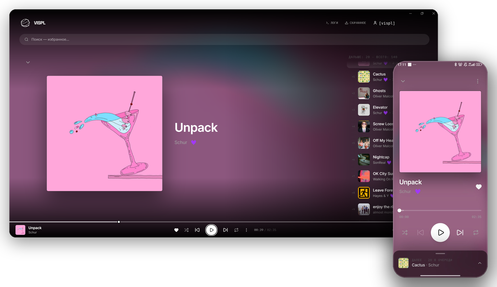
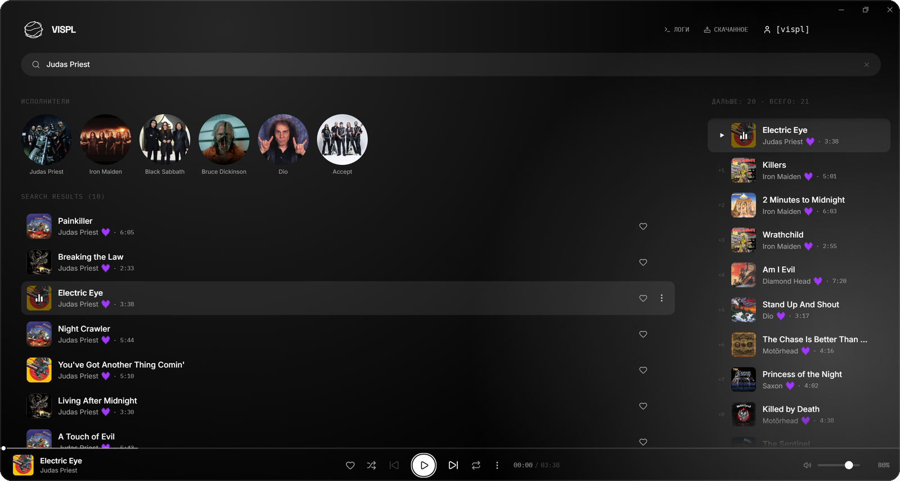
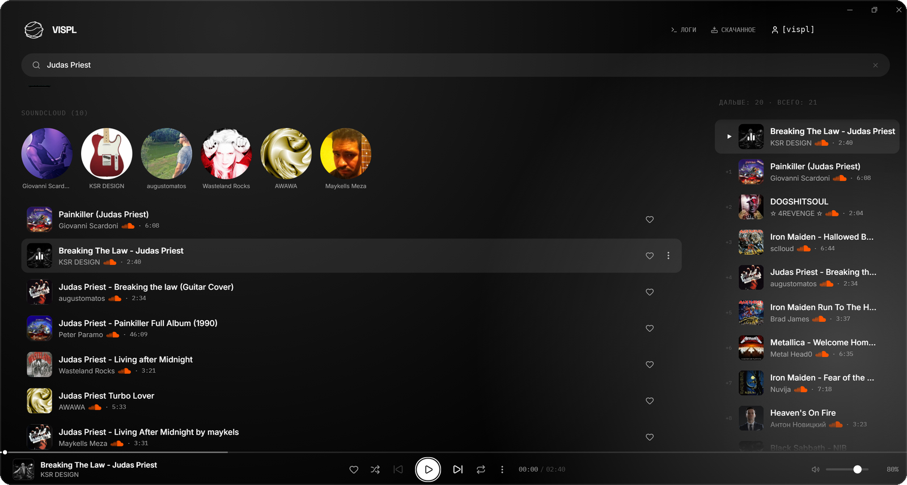
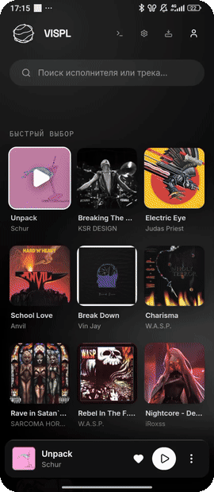
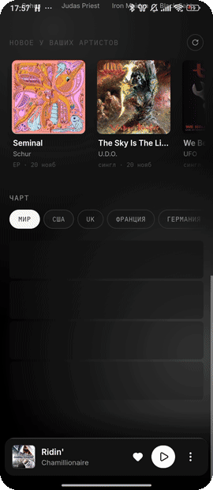
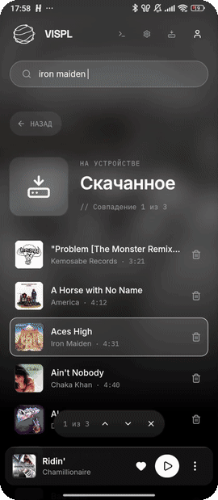
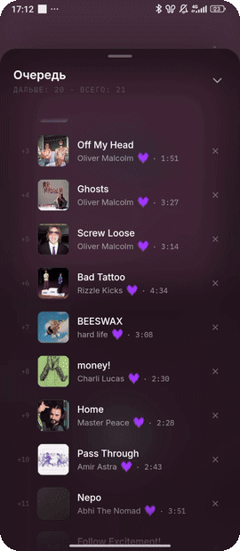
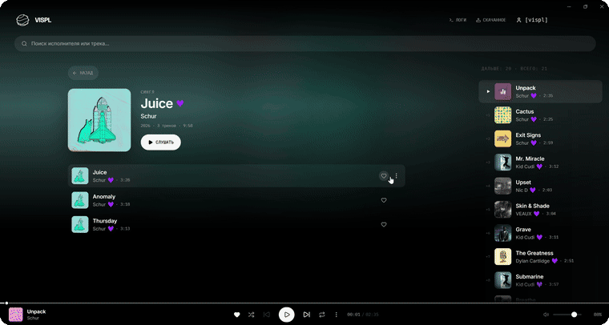
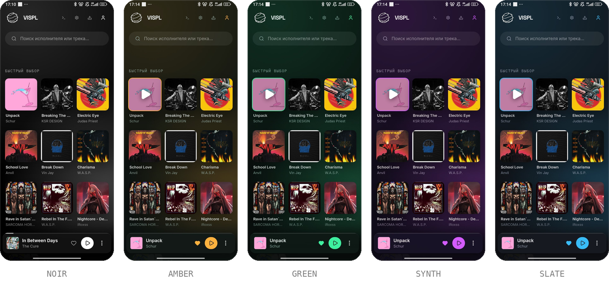

  

<b>Deezer и SoundCloud в одном плеере — на телефоне и на компьютере</b>

  
  
  

  
  &nbsp;
  

 

  

## Что умеет

- **Всё в одном месте** — Deezer и SoundCloud: поиск, артисты и альбомы в одном списке
- **Плейлисты и избранное** — синхронизируются между телефоном, компьютером и вебом
- **Для вас** — микс дня по тому, что вы слушаете, и новые релизы ваших артистов
- **Скачивание** — треки для прослушивания без интернета
- **Фоновое воспроизведение** — управление из шторки и с экрана блокировки
- **Обновляется само** — приложение сообщит о новой версии и поставит её

<table>
  <tr>
    <td align="center" width="50%"></td>
    <td align="center" width="50%"></td>
  </tr>
  <tr>
    <td align="center"><b>Deezer</b> исполнители и треки из каталога</td>
    <td align="center"><b>SoundCloud</b> каверы, ремиксы и всё, чего нет в каталоге</td>
  </tr>
</table>

<table>
  <tr>
    <td align="center" width="33%"></td>
    <td align="center" width="33%"></td>
    <td align="center" width="33%"></td>
  </tr>
  <tr>
    <td align="center"><b>Главная</b> быстрый выбор, микс дня, новинки</td>
    <td align="center"><b>Чарты</b> мир и отдельные страны</td>
    <td align="center"><b>Скачанное</b> поиск по своему, слушается и без сети</td>
  </tr>
</table>

## Очередь и плейлисты — как вам удобно

<table>
  <tr>
    <td width="36%" align="center"></td>
    <td>
      <ul>
        <li><b>Перетаскивание</b> — зажмите трек и тащите: в очереди и в любом плейлисте</li>
        <li><b>Телефон и компьютер</b> — пальцем на телефоне, мышью на компьютере</li>
        <li><b>Сразу везде</b> — новый порядок плейлиста сохраняется в аккаунте и виден на всех устройствах</li>
        <li><b>Ошиблись?</b> — стрелки отмены и повтора прямо над очередью</li>
      </ul>
    </td>
  </tr>
</table>

  
   Меню трека: в очередь, похожее, волна исполнителя, скачать и плейлисты — в одном окне

## Пять тем

  

## Установка

### Android
1. Скачайте [`vispl.apk`](https://github.com/arcwagner1337/vispl_releases/releases/latest/download/vispl.apk).
2. Откройте файл. Если Android спросит — разрешите установку из этого источника.
3. Нужен Android 7.0 или новее.

<!-- можно добавить QR-код на прямую ссылку apk -->

### Windows
1. Скачайте [`VISPL-Setup.exe`](https://github.com/arcwagner1337/vispl_releases/releases/latest/download/VISPL-Setup.exe).
2. Запустите — установка займёт меньше минуты.
3. Windows 10 / 11, 64-бит.

Windows пишет «Windows защитила ваш компьютер»

 

Установщик не подписан платным сертификатом, поэтому SmartScreen переспрашивает. Нажмите **«Подробнее» → «Выполнить в любом случае»**. Файлы выкладываются только здесь, в Releases.

### iPhone
Версии для iOS пока нет — [планируется].

## Обновления

Приложение само проверяет новые версии и предлагает обновиться. Список изменений — во вкладке [Releases](https://github.com/arcwagner1337/vispl_releases/releases).

## Частые вопросы

Нужен ли аккаунт Deezer?

 

Пользоваться можно и без него, но основной источник музыки — Deezer, поэтому аккаунт лучше завести: это бесплатно и быстро.

Это бесплатно?

 

Абсолютно)

Почему Windows / Android предупреждает при установке?

 

Приложение распространяется не через магазин и не подписано платным сертификатом — поэтому система переспрашивает. Файлы выкладываются только здесь.

Где мои данные?

 

Плейлисты и избранное — в аккаунте VISPL; скачанные треки — в «Музыка/Vispl». Данные аккаунтов сторонних сервисов (Deezer) хранятся на вашем устройстве и не передаются третьим лицам.

## Связь

- [Баги и пожелания: Issues / Telegram / почта]
- [Канал с новостями]

 

VISPL — независимый проект и не связан с Deezer или SoundCloud. Исходный код закрыт во избежание блокировок, здесь лежат только сборки.
